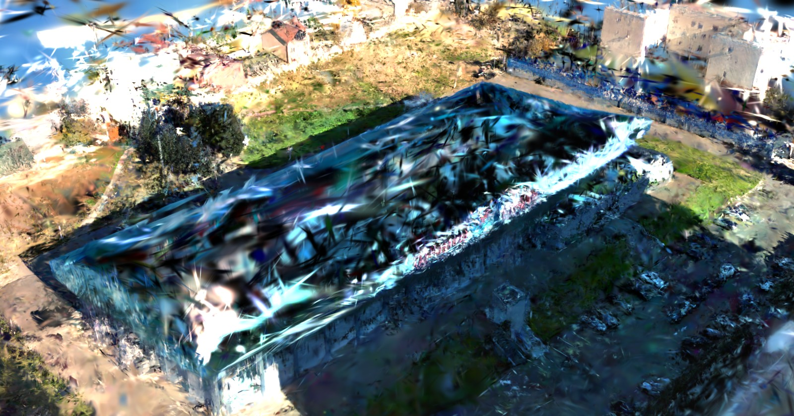

# theta-360-recon

360 photos of a RICOH THETA S, one stitched panorama every 8 s, turned into a mesh, a voxel model and a
Gaussian splat with COLMAP, gsplat and Open3D. Two sessions so far: a room seen from a rover (`pass-0`) and a
building walked round outdoors with the camera on a hand-held pole (`pool`).

- Write-up of the outdoor session: [Gaussian Splats from 360 Camera Footage Outdoors](https://latentstate.dev/posts/gaussian-splats-from-360-camera-outdoors/)
- The layout (one YAML per run, results next to it) follows [fpv-photogrammetry](https://github.com/format37/fpv-photogrammetry),
  the drone project. The lessons about white walls, the voxel model, the progress view and the summary page come from two
  unpublished phone projects that the code comments call `kitchen-recon` and `galaxy-s26-ultra-stereo`.



The photos themselves are not in the repository (people, and a GPS position in every file): see [Privacy](#privacy).

```
panoramas ─► masks ─► faces of a rigid rig ─► pairs ─► sparse model ─► scene frame ─► PatchMatch ─► prior + planes ─► mesh
 (photos/)   platform,                         │       (rig mapper)   up, ground,                                ├─► voxels
             people, sky                       │            │          axes, unit                                └─► splat (+ learned sky)
                                               └ loop closure └─► check against OpenMVG's spherical model
```

## What goes where

A session is a folder `data/<session>/` with the panoramas in `photos/` and one or more YAML files. Every YAML
is one variant of the run and writes into its own folder:

```
data/<session>/photos/*.JPG          stitched equirectangular panoramas, as the camera wrote them
data/<session>/rig.yaml              faces as a rigid COLMAP rig: the main run
data/<session>/spherical.yaml        OpenMVG with a native spherical camera: the check
data/<session>/out/<variant>/        faces/ masks/ labels/ colmap/ dense/ splat*/ product/ logs/ summary.md
data/<session>/summary.md            five lines of numbers
```

`rig.yaml` holds everything that can be tuned: `scene` (indoor or outdoor), the face layout, the masks, the
matching, the dense subset, the mesh and voxel sizes, the splat budget, `camera_height_cm` (the scale) and
`checks_cm` (tape numbers to check it). `data/pool/rig.yaml` has every key commented; a key left out takes the
pass-0 (indoor) value.

## Run

```bash
scripts/run.sh data/pool/rig.yaml 2>&1 | tee data/pool/out/rig/run.log    # everything
FROM=dense scripts/run.sh data/pool/rig.yaml        # from a later step: faces sparse align dense mesh voxels splat report
scripts/progress.sh data/pool/rig.yaml              # in a second terminal
PAIRS=rig scripts/run_openmvg.sh data/pool/spherical.yaml                  # the spherical check (docker)
python3 -I scripts/spherical_report.py data/pool/spherical.yaml data/pool/rig.yaml
python3 -I scripts/train_splat.py data/pool/rig.yaml --tag splat_pass --holdout-from R0013103   # train on the first passes, test on the last
python3 scripts/voxview.py data/pool/rig.yaml       # the voxel model, native window
RUN=data/pool/out/rig scripts/view.sh               # splat, mesh and voxel cubes in the browser
```

## The steps one by one

Each takes the same YAML and can be run on its own.

| step | script | writes |
|---|---|---|
| masks (platform, people, sky), faces of the rig | `split_faces.py` | `faces/`, `masks/`, `labels/`, `masks_equirect/`, `product/rig.json`, `faces.jpg` |
| what the files are, overlap of neighbours | `inspect_panos.py` | `product/inspect.json`, `contact.jpg` |
| features, pairs, matching, rig mapper | `run_sparse.sh` (`pairs.py`, `rig_mapper.py`) | `colmap/sparse/0`, `product/pairs.json`, `matches.json` |
| registered, error in px and degrees, seam, path, jumps | `sfm_report.py` | `product/sfm.json`, `sfm.png` |
| up, floor or ground, axes, lens height | `align_scale.py` | `colmap/aligned`, `product/align.json` |
| PatchMatch on every Nth panorama | `run_dense.sh` | `dense/fused.ply` |
| monocular depth tied to PatchMatch | `depth_prior.py` | `dense/prior/`, `product/prior.json` |
| planes, filled depth, coverage, TSDF | `mesh.py` | `product/mesh.ply`, `mesh_mvs.ply`, `mesh.json` |
| the voxel model | `voxels.py` (look: `voxview.py`) | `product/voxels.npz`, `voxels.ply`, `voxels_cubes.ply` |
| splat (`--depth 0.2 --tag splat_depth`: the depth-prior experiment; `--holdout-from`: a whole pass held out; `--eval-only`: score again) | `train_splat.py` | `splat/splat.ply`, `sky.png`, `metrics.json`, `eval/` |
| light copies for the viewers, pictures | `export_view.py`, `render_views.py` | `*_view.ply`, `product/renders/` |
| lengths to check with a tape, scale error | `measure.py` | `product/measure.json`, `plan.png` |
| the building alone (box `crop:` in the YAML) | `crop.py` | `product/*_building.ply`, `splat*/splat_building.ply` |
| this run next to the phone run (pass-0) | `compare.py` | `product/compare.md` |
| every number on one page | `summary.py` | `out/<variant>/summary.md` |
| pictures for a write-up: no captions, nobody in them | `figures.py` | `product/post/` |

Experiments outside the main path: `rig_refine.py` (lets bundle adjustment move the faces inside the rig:
do the two lenses show up?), `rig_mapper.py --free` (no rig at all).

## Outdoors, walking with a pole (`scene: outdoor`)

What changes against the rover in a room, and how the pipeline deals with it:

- **The operator and a companion are in every shot**, and they move with the camera: to SIFT they look like
  points at infinity. A segmentation network (UperNet-ConvNeXt-L, ADE20K, MIT licence) runs on every face and
  masks `person`, `animal` and `sky` (`mask.semantic`). The hand and the pole sit round the nadir, which no face
  reaches (the faces cover everything above about -50 deg). `labels/` keeps the classes for the splat,
  `masks_equirect/` puts the masks back on the panorama for OpenMVG.
- **Pairs.** Every face against every face of every other panorama would be 660k pairs for 144 shots. `pairs.py`
  matches the masked SIFT of all panorama pairs on the GPU (mutual nearest neighbours, 2 min), keeps each
  panorama's next `matching.window` ones plus its `matching.retrieval` most similar anywhere in the walk (the
  loop closures), and of their 64 face pairs only those that share putative matches.
- **No floor.** The THETA S does not level its stills; it writes its own tilt into the XMP. Rotated into the
  model, the tilts of all shots give one up direction (`align_scale.py`, with a check against the largest ground
  plane). The lens height is measured above the ground under each shot (a small plane through the ground points
  that shot sees 20 to 60 deg below the horizon), and the unit is the median of those heights.
- **Sky.** No feature, no depth, no fused point comes from the sky. The splat learns it as a panorama at infinity
  behind the Gaussians (`splat.sky: env`) and pays for any opacity there, so no Gaussians are spent on it and
  none float in front of it. Scores are on the scene pixels; with the sky they are higher (`psnr_with_sky`).
- **Dense.** Faces that are mostly sky get no depth map of their own (`dense.max_sky`); PatchMatch cannot be
  masked and would spend the same time on them. Photometric and normal maps are deleted after fusion
  (`dense.keep_maps: false`: 28 of the 32 MB of every face). The prior is the outdoor metric Depth Anything.
- **Mesh and voxels** keep what lies within `mesh.reach` lens heights of the walk and fuse depth up to
  `mesh.max_depth`; only facades are snapped to planes (`mesh.planes: [walls]`): the ground slopes and there is
  no ceiling. `crop.py` cuts the building out of the scene.

## pass-0 in numbers

`data/pass-0/summary.md` has the five lines; `out/rig/product/compare.md` puts the run next to the phone run.
What the experiments said on this set:

| question | answer |
|---|---|
| Does the stitching seam break matching? | No. Error within 5 deg of the seam 0.077 deg, far from it 0.070; but 29% of the keypoints there triangulate against 55%. No mask. |
| Does the panorama have one centre? | Yes, as far as 49 shots can tell: freed faces move by at most 0.4% of the lens height, error 0.0748 -> 0.0743 deg. |
| What does the rig buy? | Without it all 392 faces still register (0.067 deg), but the 8 centres of one panorama drift apart by 2.3% of the lens height (5.8% at most). |
| Rig of faces or native spherical? | Same poses: 0.08% of the path length and 0.06 deg apart. OpenMVG takes 3 min for the sparse model, the rig mapper 20. Only the rig model feeds PatchMatch and gsplat directly. |
| Do depth priors fill the walls? | In the mesh yes: 62.5% -> 90.6% of the real views covered. In the splat no: 0.3 dB worse inside the path, 1.0 dB worse beyond it. |
| Can a metric depth network set the scale? | No: it puts the lens at 49 cm (34-66 over the faces), a ceiling of 7.9 m. |
| Are the stills levelled by the camera? | No. The panoramas' own up is 1.85 deg off the floor's normal on the rover; the tilt the camera writes into the XMP brings it to 1.2 deg. |

COLMAP 3.11 pitfall found on the way: `image_undistorter --max_image_size` resizes the images of a pinhole
camera but leaves the camera at the old size; `run_dense.sh` repairs the workspace cameras before PatchMatch.

## pool in numbers

`data/pool/summary.md` has the five lines, `out/rig/summary.md` every number, `out/rig/product/renders/` the pictures.
A walk of 19 min round a sports building with a pool, the camera on a pole held up by hand: 144 shots 8 s apart, which at
walking pace is 5 lens heights from shot to shot (about 9 m if the lens was at 1.7 m), twice round the building and
through its car parks, 768 lens heights in all. The roof was never in view. What it showed:

| question | answer |
|---|---|
| Does a walk with a 360 camera register? | Yes: 144/144 panoramas in one model, 0.074 deg (pass-0: 0.075); 699 loop closures (the front facade was walked twice: up to 18,000 inliers between the passes). `pairs.py` picked 25,175 face pairs instead of 660,000: matching 2.5 min, mapper 16 min (pass-0: 20 min for 49 panoramas). |
| Are the poses right? | OpenMVG with its spherical camera, on the same masked photos, agrees to 0.22% of the walk (rms) and 0.34 deg, with one exception: R0013079, under the pines (97 sparse points), which the rig mapper put 17 lens heights off the walk. It was taken out; `sfm_report.py` now flags such a spike and `align_scale.py` drops it. |
| People in every shot? | The operator and a companion walk with the camera and stay in place in the picture. The segmentation network masks people (14% of the backward faces) and the sky (75% of the upward ones). Their shadows stay in. |
| Where is up outdoors? | The THETA levels its stills with an accelerometer that walking shakes: their ups spread 4.6 deg (median), 24 at most; the tilt it writes into the XMP does not agree better (4.8). The robust mean of 143 stills is the up; the largest ground plane is 1.1 deg from it. |
| How high is the lens? | The sparse model has little ground right round a hand-held camera (the people hide it, the next shot is 5 lens heights away): measured at 58 of 143 shots, 0.53-1.29 of the median (10-90%). The outdoor depth network says one lens height is 1.66 m, but 0.6-3.2 m from face to face: a hint, not a scale. |
| Dense? | The weak step. PatchMatch keeps a depth on 13% of the pixels (pass-0: 55%): seen from shots 5-10 lens heights apart, a surface changes too much for its consistency filter. The prior fills 98%, but a second panorama confirms only 18% of the prior's pixels, and far buildings come out as phantom sheets in front of the camera (their faces have PatchMatch depth on the near ground only, and the prior's correction is extrapolated from there). Mesh: 16.1M triangles, it covers 64% of the real views. |
| Voxels? | 206k voxels of 0.1 lens heights, 113 x 100 x 15. Free-space carving removes the phantoms, but no more than 2 panoramas behind a voxel can be asked for: 3 left 39k of the 3.2M on the fused surface. The facades and the teal roof edge stand, the ground is patchy. |
| Splat? | The best of the three for this walk: the whole site reads from above (`renders/splat_aerial.jpg`). Held-out panoramas: 17.2 dB / SSIM 0.61 between trained shots, 14.5 beyond the end of the walk; with the sky 19.1 / 17.9 (pass-0: 35.0 / 27.2 from shots a few cm apart). Close to the camera it smears: each near surface was seen from one or two shots. Three changes made it work: train in a normalised frame (gsplat's step sizes and MCMC noise assume one; in lens heights the loss rose from step 8000: 14.5 / 12.9 dB, `splat_unnormalised`), penalise opacity and size only for the Gaussians in view (else half of them faded by step 4000), start from the fused cloud as well as the sparse points (744k instead of 92k). Depth supervision, which cost pass-0 1.0 dB beyond its path, gains 0.7 dB beyond this one at the same score inside (`splat_depth`). The roof, never seen, is noise. |
| Does it hold on another pass? | The walk goes 2.4 times round the building. A splat trained on the first two loops (111 panoramas, `splat_pass`) and tested on the 32 panoramas of the third pass: 16.2 dB / SSIM 0.53 / LPIPS 0.49, against 17.2 / 0.61 / 0.48 between trained shots and 14.5 / 0.39 / 0.53 beyond the walk. The distance to the trained path decides: 17.4 dB for the 9 panoramas within 2 lens heights of a trained shot, 16.3 for the 17 at 2-8, 14.2 for the 6 at 10-17. Even 0.1-0.4 lens heights from a trained shot, a view from the other pass scores 18-19 dB (trained views: 23.4). |
| Scale? | No tape number yet: everything is in lens heights. The building is 71.0 x 24.8 lens heights between facade lines (the north and east lines weakly seen). One number on a tape (the lens height above the ground, or the building's length) gives metres. |

Pitfalls found on the way: `pgrep -f` / `pkill -f` with a pattern that is also in the waiting shell's own command line
match that shell; Open3D's TSDF keeps 32 bytes a voxel and ran out of 46 GB on prior-filled far surfaces (depth beyond
the reach is no longer fused); MCMC with its penalties on all Gaussians, or in an unnormalised frame, faded or unsettled a
splat of a long walk (see `train_splat.py`).

The next take: stop and go, or walk slowly (2 lens heights, 3-4 m, per shot: PatchMatch and the splat need neighbours
that see a surface alike); a second loop farther out; lock the exposure if the app allows; tape the lens height or one
length of the building. The roof needs a raised view (a drone, or a 4-5 m pole).

## How a 360 camera gets into COLMAP

- COLMAP has no spherical camera model (3.11 CLI and pycolmap 3.13 alike). A panorama is cut into pinhole
  faces that share one centre. Their rotations and intrinsics are exact, because we render the faces
  ourselves, so bundle adjustment solves only six numbers per panorama.
- COLMAP 3.11 knows rigs only in `rig_bundle_adjuster`, after an ordinary mapper run. From 3.12 on rigs and
  frames are part of the mapper. Here SIFT and matching run on the GPU with the 3.11 CLI and the mapping
  runs in pycolmap 3.13 on the same database: it adds the rig and frame tables to it. `sfm.mapper` in the YAML
  passes options through (pool: fewer global adjustments, redundant points left out of them).
- Faces of one panorama are never matched with each other: they share their centre, a match between them
  has no baseline.
- The rover is bolted to the camera, so it is the only thing that stays in place while the floor moves.
  `split_faces.py` finds it by correlating every shot with the median of all shots (`mask.rover: auto`).

## Scale

`camera_height_cm` in the YAML is the height of the lens centre above the floor (outdoors: above the ground
under the shots, the median over the walk). Indoors the floor is a plane fitted to the sparse points and the 49
lens heights above it should all be the same number; their spread is the internal check. Outdoors the spread is
mostly how steadily the pole was carried. `measure.py` lists lengths that do not depend on that number (ceiling
height, wall to wall, facade to facade); put tape values for them into `checks_cm` and it prints the error.

```yaml
camera_height_cm: 21.5
checks_cm: {"ceiling height": 271.0}
```

The whole pipeline works in one unit, the lens height (floor at z = 0, lens at z = 1), so nothing has to be
run again when the tape number arrives or changes. `measure.py` alone converts: it prints the lengths in cm
and writes `product/mesh_metric.ply` and `<splat>/splat_metric.ply` in metres. The GPS in the photos does not
help: on the pool walk the phone updated it 3 times in 144 shots.

## Requirements

- Linux, an NVIDIA GPU (PatchMatch and gsplat need CUDA; 24 GB was used).
- COLMAP 3.11 with CUDA on `PATH`; `pip install -r requirements.txt` (pycolmap 3.13, gsplat 1.4, Open3D 0.19, torch 2.10 and
  transformers 4.57 were used; `lpips` is optional).
- Docker for the OpenMVG check: `docker build -t openmvg:local tools/openmvg` (10 min).
- From Hugging Face, on first use: the depth prior `Depth-Anything-V2-Metric-Indoor-Large` (CC-BY-NC-4.0: fine
  for a test, not for a paid job; the `-Small-` model is Apache-2.0 and is set with `dense.prior_model`) or, outdoors,
  `-Metric-Outdoor-Large` (its card says Apache-2.0, but the Large Depth Anything V2 weights it starts from are
  CC-BY-NC-4.0: check before a paid job); the segmentation network `openmmlab/upernet-convnext-large` (MIT).
- A display for the voxel screenshots of `render_views.py` (voxview); everything else renders headless.

## License

MIT.

## Privacy

The THETA writes its GPS position into every JPEG. Strip it before a photo leaves this machine:
`exiftool -gps:all= file.JPG`. Nothing in this pipeline uploads photos. People in the photos are masked for the
reconstruction, not blurred in the photos themselves.
